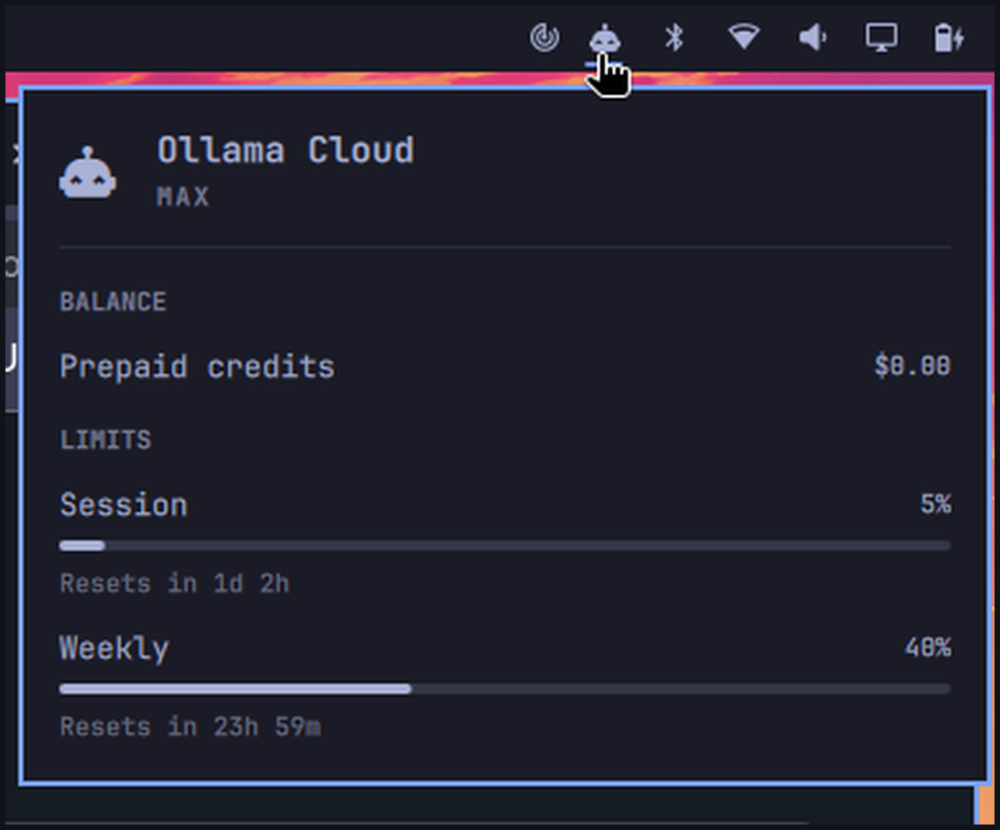

# Ollama Cloud Usage

Adds **Ollama Cloud** to Omarchy's **existing AI toolbar widget** — the AI icon already on the top bar. It does not add a second icon.

After install, click that same AI button. You get an **Ollama Cloud** provider next to Claude Code / Codex: your plan tier, the 5-hour session and weekly limit meters, extra-usage balance, and per-model request counts as recorded by the ollama-meter companion.

Preview:



## Install

```sh
omarchy plugin add https://github.com/styles01/omarchy-ollama-cloud.git --enable
```

Requires:

- Omarchy with the stock AI widget enabled (`omarchy.agents`, on by default)
- Python 3 on `PATH` (stdlib only)
- An **ollama-meter** companion reachable on the network (HTTP on port `8615`, UDP beacon on port `8616`)

No browser, no ollama.com sign-in and no keyring are needed — the collector only speaks plain HTTP to the meter. ollama.com is never polled here; the meter on the mini is the only poller (ollama.com rate-limits to 10 req/min shared).

Leave the built-in AI icon where it is. After the first scan (up to 15 minutes after login, or immediately after a panel refresh), click the AI icon and switch to **Ollama Cloud**.

## Usage

- Left click the existing AI icon: usage panel
- Switch to **Ollama Cloud** with the provider in the panel
- `r` or Enter in the panel: refresh (Ollama Cloud follows the stock update)
- Ollama Cloud also refreshes about every 15 minutes

This plugin is a headless service. It only writes an Ollama Cloud usage record for the stock panel to display.

**Meter discovery**, in order:

1. explicit `--meter-url http://<host>:8615` or `OLLAMA_METER_URL=http://<host>:8615`
2. the last URL that produced a good summary (cached in `~/.local/state/omarchy/agents/usage/ollama-meter-url`)
3. the meter's UDP beacon on port `8616` (`OLLAMA-METER <ip> <port>`)
4. the mDNS name `ollama-meter.local` on port `8615`

The collector reads `GET /api/summary` and renders the session/weekly used percent and reset times. Since the meter switched to ollama.com's native `/api/balance` (`quota_source: "balance-api"`), percentages are balance-derived and the extra-usage balance comes from `cloud.purchased_balance_usd`; older summaries (`quota_source: "calibration"`, with `session_quota`/`weekly_quota`) render identically — those quota fields are simply not needed. Discovered meter URLs are cached locally (an IP, not a credential).

If the meter is unreachable, the last good record is kept so the panel chip does not blank; with no prior record the panel shows "--" instead of crashing.

## Remove

```sh
omarchy plugin remove io.github.styles01.ollama-cloud
```

Removal deletes the plugin checkout and drops `~/.local/state/omarchy/agents/usage/ollama.json`, so the Ollama Cloud provider leaves the stock AI panel. It does not change browser profiles, cookies, or sessions.

## Privacy

The collector fetches one local HTTP endpoint. No cookies, tokens, or page content are written anywhere — only the usage numbers land in the state file.

## License

MIT. See [LICENSE](LICENSE).